<div align="center">



<br>

[](https://github.com/NasamuAlhassan/MTN/actions/workflows/ci.yml)


</div>

<br>

## The problem

A self-service app only serves you if you can **read it** and already **know what things are called**.

To buy cheap night-time data in a telco app today, you have to know the product is called *Midnight Bundle*, know it lives under *Data → Categories*, and read enough English to get there. Someone who thinks *"I want data for tonight"* — in Twi, in Kusaal, or out loud in English — has no way in. They fall back to USSD strings, or they walk to an agent.

**Zigi closes that gap.** You say what you need. It works out which product that is, asks one small question at a time, reads the whole thing back before a single pesewa moves, fills in the real screen, and then steps aside for the PIN.

<br>

## See it work

<div align="center">

</div>

The left is what the customer sees. The right is the dialogue engine filling its slots in step. Notice what happens at the end: **the assistant hands off at the PIN and goes blind.** It never receives, renders, or transmits the PIN — that gate belongs to the app.

<br>

## Say any of these

The prototype ships with mock balances and contacts, so every phrase below actually resolves.

| Say this | Zigi resolves it to | Intent |
|---|---|---|
| *"I want data for the night"* | Midnight Bundle — 1.5GB, GHS 2, 12am–5am | `night` |
| *"Data that won't finish"* | Flexi Data Bundle — non-expiry | `lasting` |
| *"Small data for WhatsApp"* | Social bundle, then asks the duration | `social` |
| *"Send 20 cedis to Prince"* | MoMo transfer, asks for a reference, reads it back | `send` |
| *"Buy me airtime"* | Airtime, asks whether it's for you or someone else | `airtime` |
| *"Call and browse together"* | Mashup — voice + data + SMS | `mashup` |
| *"How much data do I have?"* | Speaks the balance, no navigation | `balance` |
| *"What did I send last week?"* | Recent transactions, not a new transfer | `transactions` |

That last row is deliberate. *"What did I send"* and *"send"* share a word; history is matched **before** transfers so a question about the past can never open a payment screen.

<br>

## How one turn travels

<div align="center">

</div>

<br>

## Four decisions worth defending

**1 · Understand the need, not the menu name.**
Intent matching runs on what the customer *wants* — `"data that won't finish"`, `"cheap data for the night"` — and maps it to the product. The customer never has to learn the catalogue.

**2 · Read it back before it costs money.**
Every path that spends money ends in a spoken *and* on-screen read-back with the recipient, the amount, the digits spaced out one at a time, and the reference — then waits for a yes. Ambiguity resolves to *don't proceed*: `isNo()` deliberately has no bare `"n"`, so a noisy transcription can't cancel a transfer, and anything that isn't a clear yes simply re-asks.

**3 · The assistant stops at the PIN.**
Zigi prefills the real MyMTN form and speaks the hand-off line. The PIN gate is the app's. This keeps the trust boundary exactly where a customer expects it, and means no voice or AI layer is ever in scope for the secret.

**4 · Rules first, model optional.**
The dialogue engine is a pure, deterministic state machine with no network dependency. An LLM is layered *on top* and only contributes an intent above `0.55` confidence — it adds open-ended questions and messy phrasings, it isn't load-bearing. Pull every API key out and the core flows still work. Any AI-authored reply is also sanitised before it is spoken: anything mentioning a PIN, password or OTP, or containing a link, is dropped.

<br>

## Architecture

| Layer | Location | Responsibility |
|---|---|---|
| UI | `src/screens`, `src/components` | MyMTN-style shell, assistant sheet, PIN gate |
| Orchestration | `src/App.jsx` | Navigation stack, voice pipeline, conversation state |
| Dialogue | `src/voice/dialogue.js`, `intents.js`, `nlu.js` | Pure FSM: utterance → intent → slots → read-back → dispatch |
| Understanding | `src/voice/understand.js`, `aiNlu.js`, `khayaPipeline.js` | Khaya translation, optional LLM, rule fallback |
| Voice I/O | `src/voice/asr.js`, `tts.js`, `src/khaya/*` | Provider selection, audio decode/playback, caching |
| Services | `api/_lib/handlers.js`, `api/**` | Key injection, rate limiting, timeouts |

```
api/                      server-side proxy — the only place API keys exist
  _lib/handlers.js        shared Khaya + Gemini + Groq logic, rate limiting
  khaya/[...path].js      ·  gemini.js  ·  groq/[...path].js
src/
  App.jsx                 navigation stack, voice wiring, PIN handoff
  voice/                  intents · nlu · dialogue FSM · asr · tts · understand
  khaya/                  Khaya REST client, audio playback, speech queue
  groq/                   Whisper STT + Llama NLU client
  screens/                Home · Buy · MoMo · More + ~20 sub-screens
  components/             PhoneFrame · TabBar · AssistantSheet · PinGate
  data/                   mock user, contacts, bundles, transactions
  content/                English narration, translated at runtime for tw/kus
docs/                     ARCHITECTURE.md · RUNBOOK.md · adr/
```

Navigation is a stack of `{tab, sub, meta}`, and screens are **derived from conversation slots** — so the form visibly fills as the customer talks, rather than appearing fully-formed after a confirmation they can't audit.

<br>

## Voice providers

Selection is automatic, with graceful degradation at every step.

| | Twi / Kusaal | English |
|---|---|---|
| **Speech → text** | Khaya ASR v3 → Groq Whisper → Web Speech | Groq Whisper → Khaya → Web Speech |
| **Translation** | Khaya, local ↔ English | not needed |
| **Text → speech** | Khaya TTS v2 | Web Speech |
| **Understanding** | Groq Llama → Gemini → rules | Groq Llama → Gemini → rules |

Local-language replies are **translated at runtime**, so there are no pre-recorded clips to maintain — new copy is instantly available in every language. If Khaya STT fails mid-turn, the *same recording* is re-sent to Whisper rather than making the customer repeat themselves. If Khaya TTS fails, the line degrades to spoken English instead of silence, because the text is already on screen.

Default with zero configuration: Web Speech, English. Everything else is additive.

<br>

## Where the keys live

Vite inlines any `VITE_`-prefixed variable into the client bundle. So the provider keys carry **no** such prefix and are read only by the proxy.

```
browser  ──►  /api/khaya/*  /api/gemini  /api/groq/*  ──►  provider
              └── key injected here, server-side ──┘
```

- **Production** — Vercel functions in `api/`.
- **Development** — the *same* handlers mounted as Vite middleware (`vite.config.js`), so there is one code path, not two.
- The proxy enforces per-IP rate limiting, 30-second upstream timeouts, and strict path/model allowlists so it can't be turned into an open relay.
- Only the non-secret `VITE_*_ENABLED` feature flags reach the browser.

See [`SECURITY.md`](SECURITY.md) and [`docs/adr/0001-server-side-proxy-for-provider-keys.md`](docs/adr/0001-server-side-proxy-for-provider-keys.md).

<br>

## Quality gates

Every gate runs in CI on push and PR.

```bash
npm run lint        # ESLint (flat config)
npm run typecheck   # tsc --noEmit — checkJs + JSDoc across the pure core
npm test            # 82 tests, 9 files
npm run e2e         # Playwright, desktop + mobile viewports
npm run build       # production build
npm run check       # all of the above in one shot
```

- **Unit** — intent matching, slot parsing (including the phone-number-vs-amount case), every flow, read-back → PIN hand-off.
- **Component + accessibility** — `PinGate` and the full `App` shell rendered with Testing Library and asserted with **jest-axe**; zero structural violations.
- **Proxy** — key injection, 405/400 validation, rate limiting.
- **End-to-end** — first-run language pick → buy airtime → confirm → PIN gate, plus a **keyboard-only** path.

<br>

## Run it

```bash
npm install
npm run dev
```

Open the URL Vite prints, pick a language, tap the Zigi bubble, and talk to it. No API keys are needed to try the core flows.

To enable local-language voice or the LLM, copy `.env.example` to `.env`, add the keys you have, and flip the matching public flag:

```bash
KHAYA_API_KEY=…          VITE_VOICE_ENABLED=true     # Twi + Kusaal voice
GROQ_API_KEY=…           VITE_GROQ_ENABLED=true      # Whisper STT + Llama NLU
GEMINI_API_KEY=…         VITE_AI_NLU_ENABLED=true    # fallback NLU
```

Deploy on Vercel with the framework preset **Vite**, and set the same variables in *Project Settings → Environment Variables*. Full procedures, including key rotation, are in [`docs/RUNBOOK.md`](docs/RUNBOOK.md).

<br>

## What a production version would need

Stated plainly, because a prototype that hides its gaps isn't useful to anyone evaluating it:

- **Durable rate limiting.** The current in-memory bucket doesn't survive serverless cold starts — this wants Redis or Upstash.
- **Real backend integration.** All balances, contacts, bundles and transactions are mock data in `src/data/`.
- **Human-verified language quality.** Runtime machine translation is the right call for iteration speed, but customer-facing telco copy needs native review, and fixed narration is better pre-recorded — which also drops runtime TTS cost to zero.
- **Wider dialect coverage.** Twi and Kusaal are two of roughly eighty Ghanaian languages.
- **Consent and retention policy** for any audio leaving the device.
- **Accessibility beyond structure.** The axe checks are automated; real screen-reader and low-literacy testing with actual customers is the bar that matters.

<br>

## Legal

Unofficial concept prototype. **Not affiliated with, authorised by, or endorsed by MTN Group, MobileMoney Fintech Limited (MMFL), or any affiliate.** "MTN", "MyMTN" and "MoMo" are trademarks of their respective owners, used here only for illustrative, non-commercial demonstration. No real money moves and no live MoMo backend is integrated. All figures, contacts and transactions are fictional. All artwork in this repository is original; no MTN campaign creative is redistributed.

See [`LICENSE`](LICENSE) — source-available for evaluation, not for commercial use or deployment.

<br>

---

<div align="center">
<sub>Built by <b>Prince Nasamu Alhassan</b> · Ghana</sub>
</div>
