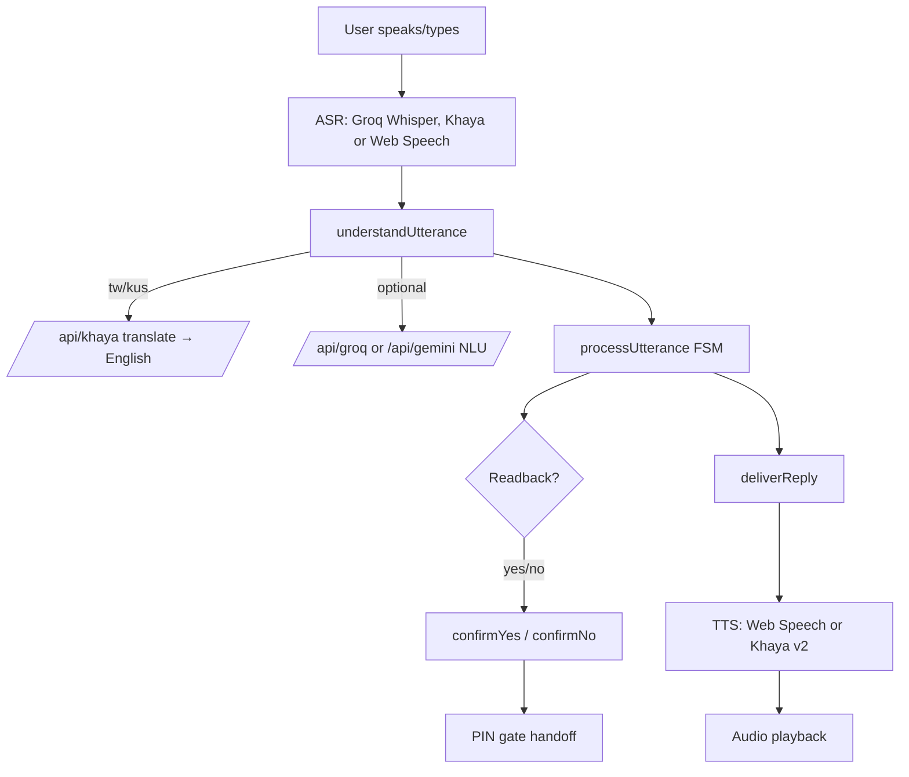

# Architecture

Zigi Voice is a **client + thin serverless proxy** app. The React client runs the
whole UX and the dialogue engine; a small proxy holds the provider API keys so
they never reach the browser.

## Layers

| Layer | Location | Responsibility |
|---|---|---|
| UI | `src/screens`, `src/components` | Presentational MyMTN shell + assistant sheet + PIN gate |
| Orchestration | `src/App.jsx` | Wires state, navigation stack, voice pipeline |
| Dialogue (domain) | `src/voice/dialogue.js`, `intents.js`, `nlu.js` | Pure FSM: utterance → intent → slots → readback → dispatch |
| Understanding | `src/voice/understand.js`, `aiNlu.js`, `khayaPipeline.js` | Khaya translate + optional LLM NLU (Groq, then Gemini) + rule fallback |
| Voice I/O | `src/voice/asr.js`, `tts.js`, `src/khaya/*`, `src/groq/*` | ASR/TTS provider selection, audio decode/playback, caching |
| Services (server) | `api/_lib/handlers.js`, `api/**` | Key injection, rate limiting, timeouts for Khaya + Gemini + Groq |

## Request flow (voice turn)

## Why a proxy

`VITE_`-prefixed env vars are inlined into the client bundle by Vite. To keep the
Khaya, Gemini and Groq keys off the client we route every provider call through
same-origin `/api/*`. The **same** handlers back both environments:

- **Prod:** Vercel functions (`api/khaya/[...path].js`, `api/gemini.js`,
  `api/groq/[...path].js`).
- **Dev/preview:** mounted as Vite middleware in `vite.config.js`.

The proxy also enforces per-IP rate limiting, upstream timeouts, and strict
path/model allowlists so it cannot be used as an open relay.

Only the non-secret public flags `VITE_VOICE_ENABLED` / `VITE_AI_NLU_ENABLED` /
`VITE_GROQ_ENABLED` reach the browser.

## Key design decisions

See `docs/adr/` for the reasoning behind the proxy, the rule-based FSM, and the
provider-abstraction layer.
